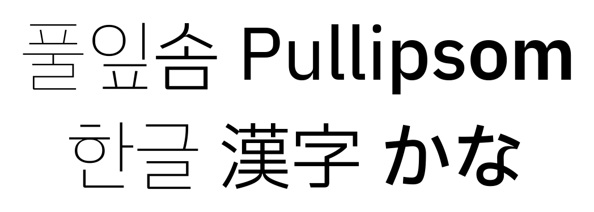
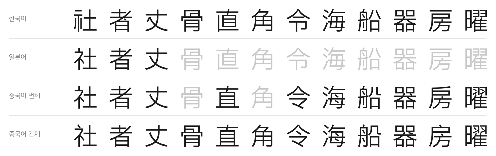
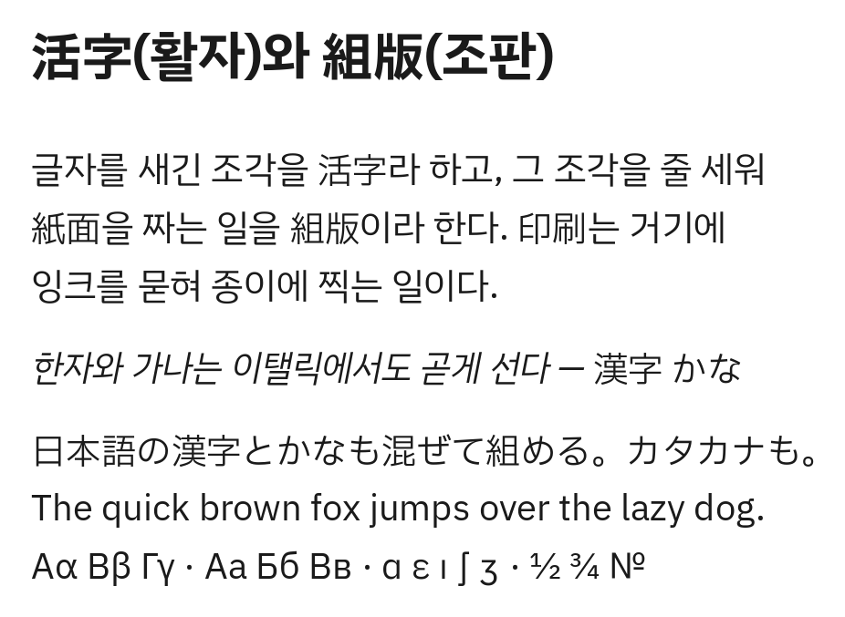
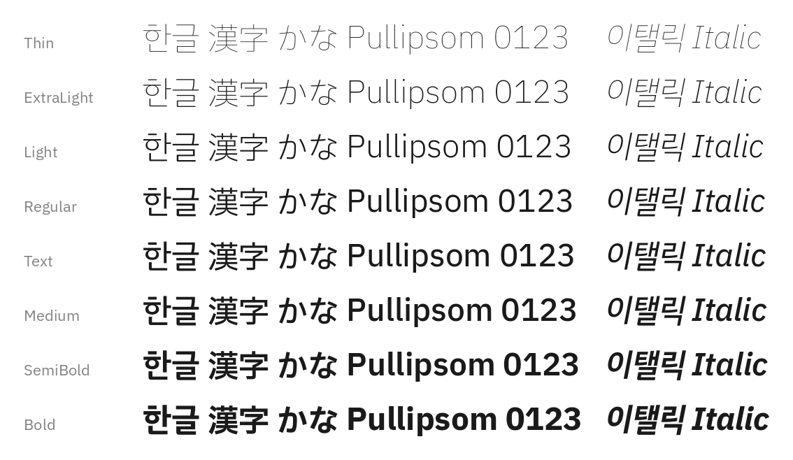
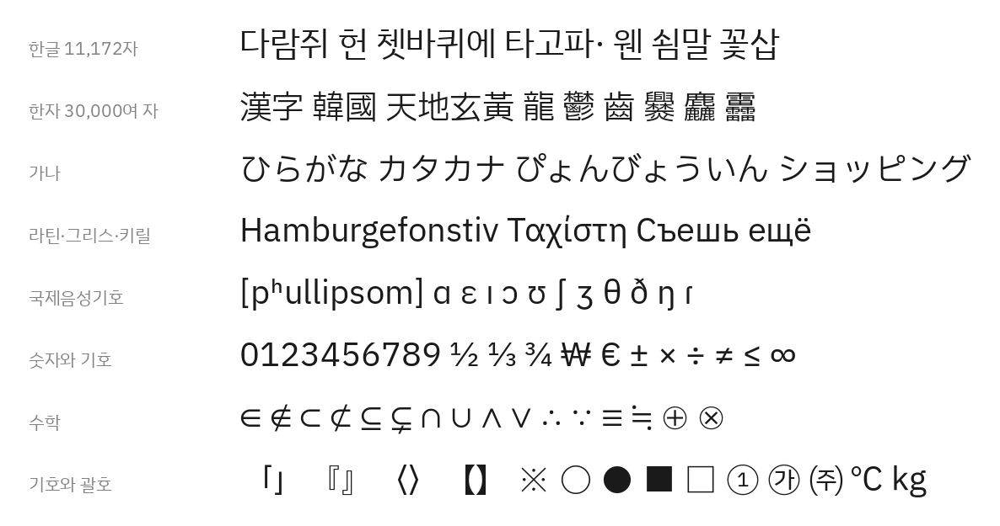

# Pullipsom (풀잎솜)

[한국어](README.md) · English

A proportional CJK font that adds Han characters and kana to IBM Plex Sans KR.

| | |
|---|---|
| **Coverage** | Latin, Greek, Cyrillic, 11,172 Hangul syllables, 30,000+ Han characters, kana |
| **Weights** | Eight weights from Thin to Bold, each with an italic |
| **Han forms** | Korean forms by default; Japanese or Chinese forms when the text is tagged with that language (`locl`) |

If you need a monospaced font, use [Monoplex](https://github.com/y-kim/monoplex), a programming font for terminals and editors built from IBM Plex Mono.

# Source fonts

When several fonts have the same code point, the first one in this order wins.

```
IBM Plex Sans    →  Plex Sans KR       →  Plex Sans JP  →  Plex Sans TC     →  Plex Sans SC
Latin·Greek·       Hangul, Korean       Kana, Han        More Han           Simplified Han,
Cyrillic           symbols                                                  Extension A
```

# Han forms by language

Han characters appear in their Korean forms. When the text is tagged with a language (`lang` in HTML, the language setting in a word processor), they switch to that language's forms.

| Language | Forms |
|---|---|
| Korean, or no language | Korean forms |
| Japanese | IBM Plex Sans JP |
| Traditional Chinese (Taiwan · Hong Kong · Macau) | IBM Plex Sans TC |
| Simplified Chinese | IBM Plex Sans SC, for characters in GB 2312 only |

Simplified Chinese switches only the characters in GB 2312 (6,763 characters), because of the font's glyph limit. IBM Plex has no Hong Kong or Macau forms, so those use the Taiwan forms.

The image shows "the library's designer" in each language. The rows, from the top, are Korean, Japanese, Traditional Chinese and Simplified Chinese. Grey characters either look the same as their Korean form, or are a different code point from the Korean text (図 and 图 for 圖, or kana like の), so there is nothing to switch.



On a web page, set the language with `lang`.

```html
<p lang="ko">圖書館의設計者</p>      <!-- Korean forms -->
<p lang="ja">図書館の設計者</p>      <!-- Japanese forms -->
<p lang="zh-Hant">圖書館的設計者</p> <!-- Traditional Chinese forms -->
<p lang="zh-Hans">图书馆的设计者</p> <!-- Simplified Chinese forms -->
```

## Sources for the Korean forms

- The 1,800 basic Han characters for education, from the Korean textbook editing guidelines (편수자료, 2007 revision)
- KS X 1001:2004
- For all other Han characters, the first glyph found in IBM Plex Sans JP → TC → SC

# Recipe

IBM Plex Sans KR left traditional CJK metrics behind and laid out its Hangul to match the Latin letters of IBM Plex Sans. Han characters and kana, which still use CJK metrics, were never included in IBM Plex Sans KR. This font scales and shifts those Han characters and kana to sit well with the Hangul of IBM Plex Sans KR, and puts everything into one font. [RECIPE.md](RECIPE.md) (in Korean) explains how.

# Gallery

**Hangul, Han and kana mixed.** Han characters and kana stay upright in the italics.



**Eight weights and italics**



**Coverage**



# Installation

Download the fonts from the releases page: https://github.com/y-kim/pullipsom/releases

The archive holds two sets. Install only one of them.

| | When |
|---|---|
| `hinted/` | Windows. Strokes snap to pixels at small sizes (12–16px), so text stays sharp |
| `unhinted/` | macOS, high-resolution screens, the web. These don't use hinting, and the files are about half the size |

Install the fonts the usual way for your operating system.

# Building

The build tool lives in the [hapchija](https://github.com/y-kim/hapchija) repository and comes in as the `tools/` submodule. The source fonts are too large to keep in the repository, so the build downloads them.

```bash
git clone --recursive https://github.com/y-kim/pullipsom
cd pullipsom

# Download the source fonts (170MB)
PYTHONPATH=tools/src python3 -m hapchija fetch --recipe recipes/pullipsom.json

docker run --rm -v "$(pwd):/work" ghcr.io/yuru7/composite-font-builder \
  bash -c "cd /work && PYTHONPATH=tools/src python3 -m hapchija build --recipe recipes/pullipsom.json"
```

These documents are in Korean.

| Document | Contents |
|---|---|
| [HOW_TO_BUILD.md](HOW_TO_BUILD.md) | How to build |
| [RECIPE.md](RECIPE.md) | What the recipe does and why |
| [VERSIONING.md](VERSIONING.md) | How versions are numbered |
| [CHANGELOG.md](CHANGELOG.md) | Change history |

# Source fonts used

The internal version is the value written inside the font file. It can differ from the release package's number.

| Font | Internal version | Upstream release | Used for |
|---|---|---|---|
| IBM Plex Sans | 3.005 | [`@ibm/plex-sans@1.1.0`](https://github.com/IBM/plex/releases/tag/%40ibm%2Fplex-sans%401.1.0) | Latin, Greek, Cyrillic, italics |
| IBM Plex Sans KR | 1.002 | [`v6.4.2`](https://github.com/IBM/plex/releases/tag/v6.4.2) (the last combined release) | Hangul, Korean symbols |
| IBM Plex Sans JP | 1.004 | [`@ibm/plex-sans-jp@3.0.0`](https://github.com/IBM/plex/releases/tag/%40ibm%2Fplex-sans-jp%403.0.0) | Kana, Han, IPA |
| IBM Plex Sans TC | 1.001 | [`@ibm/plex-sans-tc@1.1.1`](https://github.com/IBM/plex/releases/tag/%40ibm%2Fplex-sans-tc%401.1.1) | More Han |
| IBM Plex Sans SC | 1.000 | [`@ibm/plex-sans-sc@1.1.0`](https://github.com/IBM/plex/releases/tag/%40ibm%2Fplex-sans-sc%401.1.0) | Simplified Han, Extension A |

The latest IBM Plex Sans KR, 1.003, dropped the halfwidth Hangul jamo, so this font uses 1.002.

# Known issues

## Two full widths

Han characters and kana are 960 units wide. The symbols, punctuation, fullwidth Latin and box-drawing characters that IBM Plex Sans KR draws at full width are 1000. Mixed on one line, the columns drift apart by 4%.

Making them one width means moving one side. Shrinking the 1000 side to 960 makes brackets sit lower than Hangul and breaks the vertical joins of box-drawing lines. Widening the 960 side back to 1000 leaves 50 units of space on each side of every Han character. For now all three are left as they are.

Symbols such as ■ ○ ★ ① ㈜ exist only in the CJK sources, so they come in at full width. No source has proportional forms for them, and narrowing them would mean drawing new glyphs.

For the same reason, among the music symbols ♩ ♪ ♭ are proportional and ♫ ♬ ♮ ♯ are full width. The Miscellaneous Technical block (⌘ ⎛ ⏎) also mixes both widths.

## Old Hangul can't be composed

The conjoining jamo (U+1100–11FF) are missing because IBM Plex Sans KR doesn't have them. All 11,172 modern Hangul syllables are included.

## 57 characters are missing from Thin only

The Thin weight of IBM Plex Sans KR 1.002 lacks 57 characters, including 51 halfwidth Hangul jamo. The other seven weights have them all.
